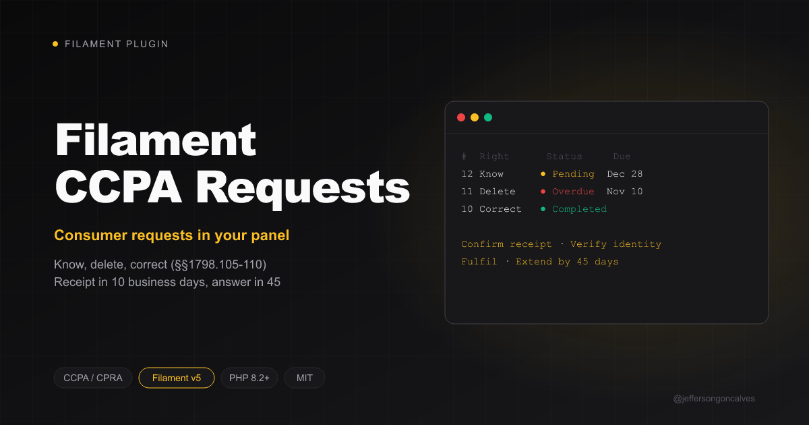

<div class="filament-hidden">



</div>

# Filament CCPA Requests

[](https://packagist.org/packages/jeffersongoncalves/filament-ccpa-requests)
[](https://github.com/jeffersongoncalves/filament-ccpa-requests/actions?query=workflow%3Atests+branch%3A2.x)
[](https://github.com/jeffersongoncalves/filament-ccpa-requests/actions?query=workflow%3A"Fix+PHP+code+styling"+branch%3A2.x)
[](https://packagist.org/packages/jeffersongoncalves/filament-ccpa-requests)
[](LICENSE.md)

A Filament panel for CCPA consumer requests to know, delete and correct (Cal. Civ. Code §§1798.105, 1798.106 and 1798.110). It is the UI of [laravel-ccpa-requests](https://github.com/jeffersongoncalves/laravel-ccpa-requests): every action calls that package, so the rules it enforces (verify first, automatic types only, 45-day deadline) stay in one place.

## Features

- Register a request to know, delete or correct. The deadline is set from `ccpa-requests.deadline` (45 days).
- **Confirm receipt** within 10 business days (Regulations §7021).
- **Extend** a request once by 45 days, with the reason you give the consumer (§1798.130(a)(2)(A)).
- **Verify identity:** link the request to the data subject's record. Nothing is exported or erased before this.
- **Fulfil** requests to know (JSON export, downloadable from the request) and to delete (deidentifies the consumer's records). Corrections are completed by hand.
- **Complete** the rights answered by hand (confirmation, correction, sharing information...) with the response you gave, or **reject** with a reason.
- Overdue requests in red, an "Overdue" filter, and a navigation badge with open requests (red when one is overdue).
- 19 languages.

## Compatibility

| Plugin Version                                                          | Filament |
|-------------------------------------------------------------------------|----------|
| [1.x](https://github.com/jeffersongoncalves/filament-ccpa-requests/tree/1.x) | 3.x      |
| [2.x](https://github.com/jeffersongoncalves/filament-ccpa-requests/tree/2.x) | 4.x      |
| [3.x](https://github.com/jeffersongoncalves/filament-ccpa-requests/tree/3.x) | 5.x      |

## Installation

You can install the package via composer:

```bash
composer require jeffersongoncalves/filament-ccpa-requests:"^2.0"
php artisan vendor:publish --tag="ccpa-requests-migrations"
php artisan migrate
```

Set up [laravel-ccpa](https://github.com/jeffersongoncalves/laravel-ccpa) first: the models listed in `ccpa.models` are the ones a request can be linked to, exported and erased.

## Usage

```php
use JeffersonGoncalves\Filament\CcpaRequests\CcpaRequestsPlugin;

public function panel(Panel $panel): Panel
{
    return $panel
        ->plugins([
            CcpaRequestsPlugin::make()
                ->navigationGroup('CCPA')                 // default: no group
                ->navigationSort(10)
                ->navigationIcon('heroicon-o-shield-check')
                ->slug('data-subject-requests')
                ->subjectModels([User::class]),           // default: ccpa.models
        ]);
}
```

All fluent methods are optional. The export disk and the deadline are configured in laravel-ccpa-requests's `ccpa-requests` config. Keep the export disk private: the file holds the data subject's personal data.

> The resource has no authorization of its own: register it only on panels whose users handle privacy requests, or add a policy for `JeffersonGoncalves\CcpaRequests\Models\ConsumerRequest`.

## Testing

```bash
composer test
```

## Changelog

Please see [CHANGELOG](CHANGELOG.md) for more information on what has changed recently.

## Contributing

Please see [CONTRIBUTING](.github/CONTRIBUTING.md) for details.

## Security Vulnerabilities

Please review [our security policy](../../security/policy) on how to report security vulnerabilities.

## Credits

- [Jefferson Gonçalves](https://github.com/jeffersongoncalves)
- [All Contributors](../../contributors)

## License

The MIT License (MIT). Please see [License File](LICENSE.md) for more information.
